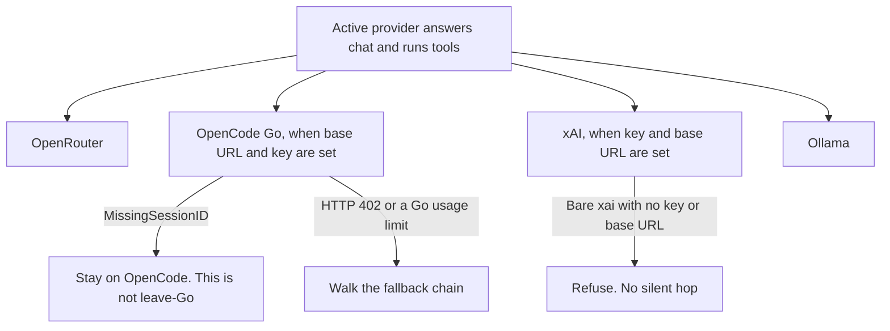

The Active provider answers chat and runs the tool loop. `/models` switches the model. Choosing another provider's model can persist `default_provider`. The wizard, and where `config.toml` lives, are on [Config](/rustfox-docs/config/). This page does not repeat that settings table.

`default_provider` is a key at the file root. When it is missing, RustFox uses the first `[[provider]]` (a legacy `[openrouter]` block counts). An unknown name fails boot. Model ids look like `provider/model` (for example `ollama/llama3.1`).

A rejected key is HTTP 401 or 403. RustFox does not walk `[fallback] chain` on those statuses. HTTP 402 is credits or payment required, and that status can walk the chain. The symptom table is on [Troubleshooting](/rustfox-docs/troubleshooting/).

Commented blocks for each provider are in [`config.example.toml`](https://github.com/chinkan/RustFox/blob/main/config.example.toml).

## OpenRouter

OpenRouter is the default path. The wizard asks for an OpenRouter key and a model. The default model is `moonshotai/kimi-k2.6`. Keys are issued at [openrouter.ai/keys](https://openrouter.ai/keys). Model ids are listed at [openrouter.ai/models](https://openrouter.ai/models).

The key is stored as `openrouter.api_key`. After the wizard or startup migrate, `config.toml` keeps `api_key = "secret:openrouter.api_key"`. The usual base URL is `https://openrouter.ai/api/v1`.

OpenRouter can be Active. It is also the provider named as the OpenCode leave-Go target (OpenRouter DeepSeek) when that model is on your fallback chain. See [OpenCode](#opencode).

## OpenCode

OpenCode is an Active peer when the Go path is configured: `type = "opencode"`, a base URL, and an API key. Chat uses OpenCode Go cloud, OpenAI-compatible completions at `https://opencode.ai/inference/go/openai/v1`. The default model is `deepseek-v4.1-flash`. RustFox keeps the tool loop. Local `opencode serve` and `opencode run` are not this chat path.

An empty base URL together with a non-empty key is filled with that Go URL. The example key reference is `secret:opencode.api_key` (or `OPENCODE_API_KEY`, or a pasted key). The setup wizard does not ask for this block.

**Active.** With both base URL and API key, OpenCode can be Active (`default_provider = "opencode"`). Without both, it stays detect-only. Settings and the setup wizard then show one of three states: absent (no `opencode` binary), no credentials, or ready with N models from `opencode models`. Chat and Active selection in that state return a typed error (`OpenCode peer path not configured` / `OpenCode cannot be Active until peer path is configured`) and do not hop to another provider. Boot refuses when `default_provider` is OpenCode without the peer path: set `base_url` and `api_key`, or choose OpenRouter or Ollama.

When OpenCode Go is Active with DeepSeek, a reply is occasionally only a short filler such as `Output.`, `Emit.`, `Final.`, or `Done.` (or a similar stub). Prefer OpenRouter for chat when that happens, or to avoid it. OpenCode can stay configured as a peer. This is not leave-Go, not `MissingSessionID`, and not a hard fail. Detect, leave-Go, and the fallback chain stay as they are.

Scheduled runs while OpenCode is Active are not part of this lock. Prefer chat. See [Features](/rustfox-docs/features/#schedule).

**`x-opencode-session`.** Every Go request (chat completions and the models list) sends a stable `x-opencode-session` header. The header is an opaque Go API requirement. The conversation transcript is SQLite, on [Features](/rustfox-docs/features/#memory). The symptom table is on [Troubleshooting](/rustfox-docs/troubleshooting/#opencode-session-and-leave-go).

**MissingSessionID is not leave-Go.** A body of `MissingSessionID` (HTTP 400, `x-opencode-session` required) stays on OpenCode. It means the session header was missing. It is not a signal to switch providers. Leave-Go is only:

- HTTP 402 (balance or credits), or
- HTTP 429 whose body is a Go usage limit (`GoUsageLimitError`, `go_usage_limit`, or policy and budget).

A plain short 429 stays on OpenCode. On the two leave-Go signals, RustFox walks `[fallback] chain`. The locked target is OpenRouter DeepSeek. The commented example entry is `openrouter/deepseek/deepseek-chat`. An empty chain has no next model. Detect-only errors do not take this path.

## xAI

xAI (Grok) is a full Active peer. `type = "xai"` calls `https://api.x.ai/v1` with OpenAI-compatible Chat Completions and a Bearer token. It is not an OpenRouter model alias. This cut does not use the Responses API. The default model is `grok-4.7`. An empty base URL or model on a `type = "xai"` block is filled with those defaults.

The key follows the OpenRouter secret-store pattern. The canonical name is `xai.api_key` (`api_key = "secret:xai.api_key"` in the example). The setup wizard does not ask for an xAI key. Set it in Settings or in `config.toml`.

With a key and a base URL, xAI can be Active. It may write `default_provider`, drive chat and the tool loop, and run the scheduler. The default fallback chain stays as it is. Add an `xai/…` entry yourself if you want one. There is no automatic hop from xAI to another provider.

**Bare `xai` does not silent-hop.** The ids `xai` and `xai/<model>` are reserved. When the peer is configured, bare `xai` is the default model (`grok-4.7`). When no `type = "xai"` block exists, or the key or base URL is missing, RustFox returns a typed error and does not use another provider:

- Chat: `xAI is misconfigured (missing API key or base URL); chat is not available`
- Active: `xAI cannot be Active while misconfigured (set api_key + base_url)`

Boot refuses when `default_provider` is xAI without `api_key` and `base_url`. The messages are on [Troubleshooting](/rustfox-docs/troubleshooting/#xai-bare-id-and-a-missing-key).

## Ollama

Ollama is the local provider. The wizard offers it next to OpenRouter. A typical block is `name = "ollama"`, `type = "ollama"`, `base_url = "http://localhost:11434/v1"`, and a model such as `llama3.1`. You can pull that model from the Ollama library. With `discover_models = true`, model discovery uses Ollama `/api/tags` on the server root (the `/v1` suffix on the base URL is stripped for that call).

A local Ollama endpoint does not need an OpenRouter key. Ollama can be Active (`default_provider = "ollama"`). A fallback entry looks like `ollama/llama3.1`.

Other local OpenAI-compatible servers (LM Studio, vLLM, llama.cpp) use `type = "openai_compatible"` in the same file. They are an extra endpoint, not a fourth peer on this page. The commented blocks are in [`config.example.toml`](https://github.com/chinkan/RustFox/blob/main/config.example.toml).
