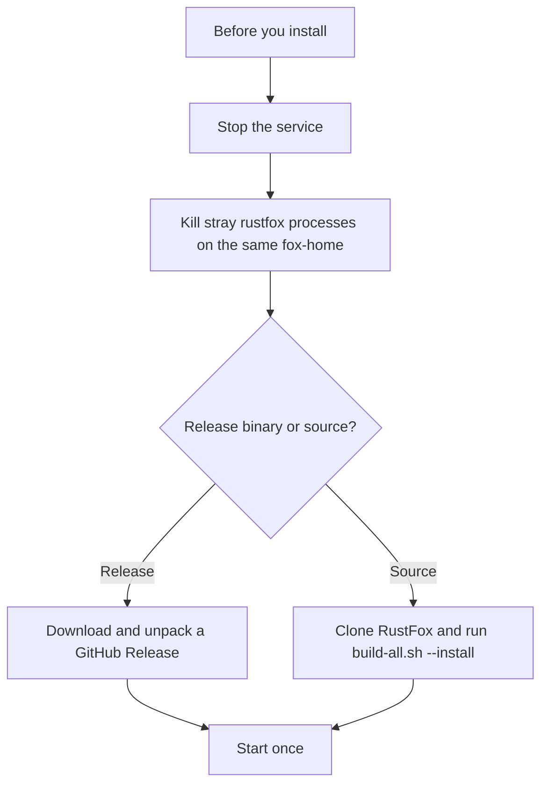

Pick one install path. Stop anything already using the fox-home before you replace the binary. See [Before you install or update](#before-you-install-or-update).



## Download a release

Download an archive from the [Releases page](https://github.com/chinkan/RustFox/releases):

```bash
tar xzf rustfox-*.tar.gz
# Windows: expand the .zip from the Releases page instead
```

### Windows: Smart App Control and SmartScreen

- **Unsigned by default.** GitHub [Releases](https://github.com/chinkan/RustFox/releases) Windows zips are **unsigned** today. Treat every published `rustfox.exe` like any other unsigned build under Smart App Control.
- **Smart App Control (SAC).** Unsigned `rustfox.exe` builds are blocked on Windows with SAC turned on, and there is no "Run anyway" button. If you build from source and hit `os error 4551`, build on a machine that does not enforce SAC. Turning Smart App Control off is not the recommended fix. Turning it back on can require a Windows reset when optional diagnostic data is off.
- **SmartScreen.** An unsigned download may still show "Windows protected your PC". Click **More info**, then **Run anyway**. This is separate from SAC.
- **Code signing (planned, deferred).** The plan is Option A (SignPath Foundation). Implementation is deferred: CI does not run SignPath or `REQUIRE_SIGNING` yet. Windows release binaries stay unsigned until the maintainer resumes that work. Planned credit when live: free code signing provided by SignPath.io, certificate by SignPath Foundation.
- **Privacy.** RustFox is self-hosted. Depending on your config it may talk to **Telegram** (bot API) and an LLM provider such as **OpenRouter** (or a local Ollama / OpenAI-compatible endpoint you choose). SignPath is not used at runtime. It would only sign the Windows release binary in CI if signing is later enabled.

## Before you install or update

Do this before the first install and before `cargo install` or any other step that replaces a binary that is already running:

1. `rustfox stop` (or `systemctl --user stop rustfox`).
2. Confirm **no stray** `rustfox` process shares the same fox-home (`RUSTFOX_HOME` / `~/.rustfox`). Kill those strays. A service restart does not clear a bare or foreground process.
3. Install (the release download above, or [Build from source](#build-from-source)).
4. Start **once** (`rustfox start`, `systemctl --user start rustfox`, or a single bare start).

`rustfox --version` and `rustfox -V` print the package version and exit 0. They do not start the bot or the scheduler. Prefer `rustfox status` for health. A bare `rustfox` starts the bot.

One fox-home maps to an exclusive **flock** on `rustfox.lock` (one bot and scheduler). A second start with the same home fails fast. Different `RUSTFOX_HOME` values may run side by side. Service verbs (`status`, `restart`, `stop`, `install`) and `--setup` stay usable while a bot is running. Flock is a belt. It does not replace stop plus kill-all before install or update.

Service verbs are listed on [Commands](/rustfox-docs/commands/). The same stop and kill-stray steps apply on [Update](/rustfox-docs/update/).

## Build from source

This is the advanced path. Most people should use a [release archive](#download-a-release). Build from a clone of [chinkan/RustFox](https://github.com/chinkan/RustFox) when you want the source tree. Clear stray processes that share the fox-home before `cargo install` replaces a live binary.

```bash
git clone https://github.com/chinkan/RustFox && cd RustFox
./scripts/build-all.sh --install
```

`build-all.sh` builds the web portal frontend first (`npm ci` + `vite build`), then the Rust binary. The portal UI is compiled into the binary, so build order matters. Other forms of the same script:

```bash
./scripts/build-all.sh                # web (vite) → dist → cargo build --release
./scripts/build-all.sh --install      # ...then install to ~/.cargo/bin/rustfox
./scripts/build-all.sh --skip-web     # reuse existing web/dist (Rust only)
./scripts/build-all.sh --profile dev  # debug build (faster compile)
```

The portal frontend is embedded into the binary at compile time (`include_dir!("web/dist")`). The script exists because of two traps:

1. **Build order.** Cargo before `vite build` embeds a stale or empty dist, and the portal renders a white screen. `build-all.sh` runs the web build first and fails if `web/dist/index.html` is missing.
2. **Stale embedding.** `include_dir!` has no Cargo change-fingerprint, so updating dist alone does not trigger a rebuild. The script touches the embedding module to force re-embedding.

If you do not need the portal, `cargo install --path . --locked` still produces a binary.

To open the embedded UI with seeded demo data, without Telegram or an LLM:

```bash
cargo run --release --example portal_preview
```

`node e2e-verify.mjs` in the RustFox repository runs the portal regression gate (Playwright: login, chat, agents, memory, tasks, settings), including a stub-dist control that catches a white screen. CI builds the web UI before Cargo tests. The same sequence applies to release builds.

Next: [Config](/rustfox-docs/config/) for the wizard. Update rules are on [Update](/rustfox-docs/update/).
