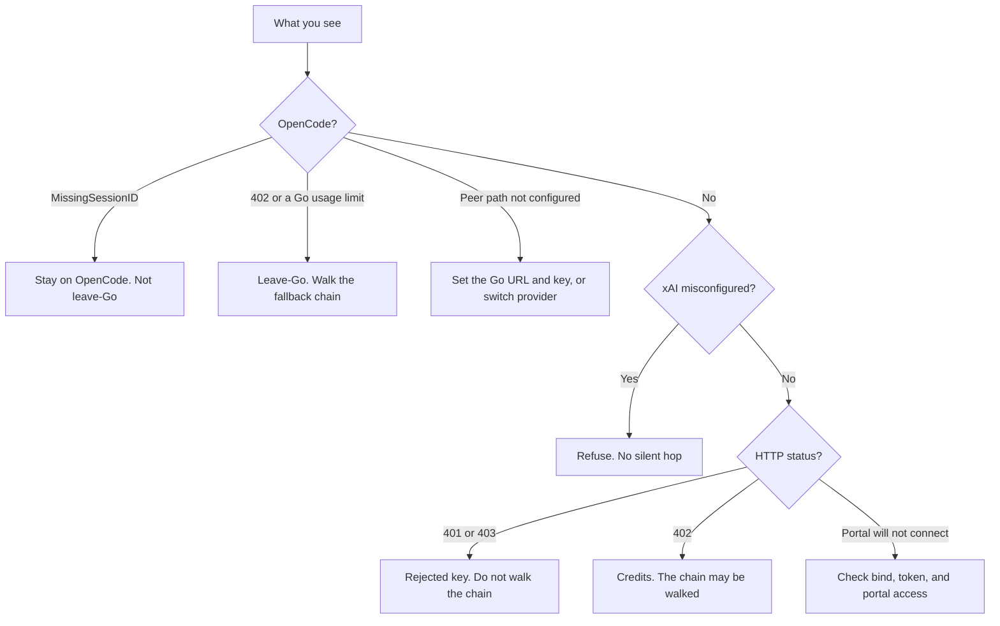

These are the symptoms with a locked meaning. Choosing a provider is on [Providers](/rustfox-docs/providers/). Turning the browser UI on is on [Portal](/rustfox-docs/portal/). Which URL to open is the [portal access runbook](https://github.com/chinkan/RustFox/blob/main/docs/portal-access.md).

## OpenCode session and leave-Go

How OpenCode can be Active is on [Providers](/rustfox-docs/providers/#opencode).

| What you see | What it means |
| --- | --- |
| `OpenCode peer path not configured`, or `OpenCode cannot be Active until peer path is configured` | Detect-only. Set the Go base URL and API key, or pick OpenRouter or Ollama. RustFox does not hop to another provider from this error. |
| Boot: `default_provider = "…" is OpenCode without peer path` | The same gap at startup. Set `base_url` and `api_key` for Go Active, or choose `openrouter` / `ollama`. |
| `MissingSessionID`, or a body that says `x-opencode-session` required (often HTTP 400) | The Go session header was missing. This is not leave-Go. RustFox does not switch you to OpenRouter because of it. Go chat and model-list requests send `x-opencode-session`. The chat transcript stays SQLite ([Features](/rustfox-docs/features/#memory)). |
| HTTP 402, or HTTP 429 with `GoUsageLimitError`, `go_usage_limit`, or policy and budget | Leave-Go. RustFox may walk `[fallback] chain` toward OpenRouter DeepSeek (example entry `openrouter/deepseek/deepseek-chat`). A plain short 429 stays on OpenCode. |
| A reply that is only `Output.`, `Emit.`, `Final.`, `Done.`, or a similar stub | Short filler while OpenCode Go is Active with DeepSeek. Prefer OpenRouter for chat. OpenCode can stay a peer. This is not leave-Go. See [Providers](/rustfox-docs/providers/#opencode). |
| Status absent, no credentials, or ready with N models | Detect only: `opencode` binary, credentials, and `opencode models`. Ready does not by itself turn chat on. |

## xAI bare id and a missing key

How a configured xAI peer behaves is on [Providers](/rustfox-docs/providers/#xai).

| What you see | What it means |
| --- | --- |
| `xAI is misconfigured (missing API key or base URL); chat is not available` | Chat hit `xai` or `xai/<model>` without a usable key and base URL. RustFox refuses. It does not silently use OpenRouter, Ollama, or OpenCode. |
| `xAI cannot be Active while misconfigured (set api_key + base_url)` | Active selection hit the same gap. Set `secret:xai.api_key` and a base URL. An empty base URL on a `type = "xai"` block becomes `https://api.x.ai/v1`. The wizard does not ask for this key. |
| Boot: `default_provider = "…" is xAI without api_key/base_url` | The same refusal at startup. Add the credential or choose another Active provider. |

A configured xAI peer does not add itself to `[fallback] chain`. Bare `xai`, when the peer is configured, is the default model `grok-4.7`. See [Providers](/rustfox-docs/providers/#xai).

## HTTP 401, 402, and credits

Provider HTTP errors are shown as `<provider> API error (<status>): <body>`.

| Status | What to treat it as |
| --- | --- |
| **401** Unauthorized, and **403** Forbidden | The key or permission was rejected. RustFox does not walk `[fallback] chain` on 401 or 403. Check that provider's credential on [Providers](/rustfox-docs/providers/). This is not a credits hop. |
| **402** Payment Required | Credits or balance. RustFox does not retry the same model for 402. It may walk `[fallback] chain`, because 402 is not an auth hard-stop. On OpenCode Go, 402 is leave-Go. Top up that provider, or rely on the next model on your chain. |
| **429** | Rate limit, or on OpenCode a usage-limit body. Only the Go usage-limit or policy body leaves OpenCode. A short 429 stays there. For other providers, 429 can walk the fallback chain (the primary model failed, so the next id is tried). |

An empty chain has no next model. The chain shape is in [`config.example.toml`](https://github.com/chinkan/RustFox/blob/main/config.example.toml). The field overview is on [Config](/rustfox-docs/config/).

## Portal access

The portal is an admin UI. Keep it on loopback or a private network. How to enable it, set `token_sha256`, and sign in is [Portal](/rustfox-docs/portal/). Which URL to open from the VPS, your LAN, or a phone is the RustFox [portal access runbook](https://github.com/chinkan/RustFox/blob/main/docs/portal-access.md). `/portal` in Telegram lists URLs for the current network. It does not invent an address the bind cannot serve.

| What you see | What to check |
| --- | --- |
| `/portal` says disabled | Set `[portal] enabled = true`, then restart (`rustfox restart` or `/restart`). |
| Login rejected | `token_sha256` is the SHA-256 of the exact token you type, with no extra space or newline. A temporary token in the startup log (`temporary login`) lasts for that process. Pin a hash when you want a stable login. |
| The browser refuses to connect, and the log says `serving on http://0.0.0.0:8090` | You opened an address this `bind` does not answer (for example bind `127.0.0.1` while using a LAN IP). Ask `/portal` which addresses are configured. |
| The portal stopped and Telegram still answers | Bind failure is best-effort. Look for `Portal: failed to start`. Check whether port 8090 is taken (`ss -tlnp \| grep 8090`). |
| A blank page at `/` | A source build embedded an empty web UI. Rebuild with `./scripts/build-all.sh` ([Setup](/rustfox-docs/setup/#build-from-source)). Release binaries from GitHub already include the UI. |
| The Tailscale URL disappeared from `/portal` | A tailnet IP can change after key expiry or reinstall. Recheck `tailscale ip -4`, or bind `0.0.0.0`. |

LAN bind is for a trusted network. Keep port 8090 blocked on any router firewall. The channel is plain HTTP. The runbook's unsupported list (public tunnels, port-forward plus DDNS) is the boundary. If you ever need a public host, put a TLS reverse proxy in front and leave `bind` on loopback. That path is described only in the [runbook](https://github.com/chinkan/RustFox/blob/main/docs/portal-access.md).
