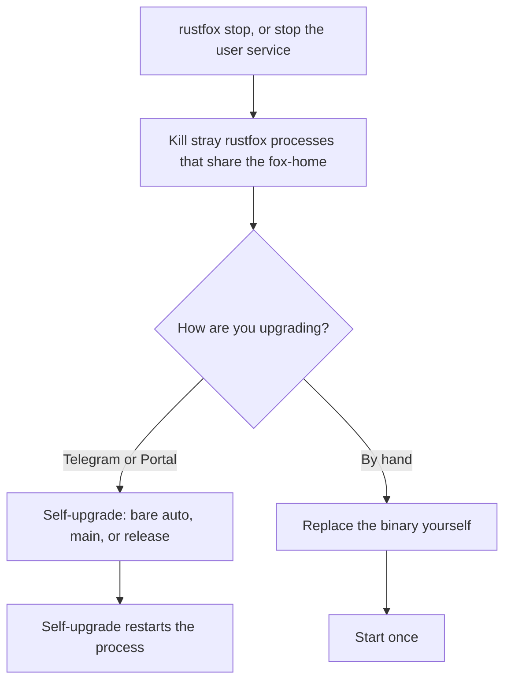

This page is the operator steps for an update. It does not change the self-upgrade engine. Stop the service and kill stray `rustfox` processes that share the same fox-home before you upgrade. `rustfox --version` and `rustfox -V` print the version and exit 0. They do not start the bot.

Longer notes: [GUIDE.md — self-upgrade](https://github.com/chinkan/RustFox/blob/main/docs/GUIDE.md#self-upgrade--ops). Command spellings: [Commands](/rustfox-docs/commands/). Install-time stop and kill-stray steps: [Setup](/rustfox-docs/setup/).

## Self-upgrade

| Surface | Label | Behaviour |
| --- | --- | --- |
| Telegram | bare `/selfupgrade` | **auto** — `Cargo.toml` near the exe → source/git; else → latest GitHub release binary |
| Telegram | `/selfupgrade main` | tip-of-`main` source build — **requires** a source tree (`Cargo.toml` near the exe); **refuse clearly** if missing (**no silent clone**) |
| Telegram | `/selfupgrade release` | download latest GitHub release binary |
| Portal Settings | `auto` \| `main` \| `release` | same mapping as Telegram |

Telegram accepts only a bare `/selfupgrade`, `/selfupgrade main`, or `/selfupgrade release`. Any other argument is rejected. It is not treated as a git branch name. Other branches stay on the built-in `self_upgrade` tool (`mode=source` plus `branch`), not on the Telegram command.

If you run from a git clone under systemd or launchd, prefer `/selfupgrade main` (or Portal `main`). A manual tmp clone, build, and `cargo install` is the fallback when there is no self-upgrade path.

A successful self-upgrade restarts the process. `rustfox restart` and Telegram `/restart` only restart the current process. They do not download or rebuild.

## Before any upgrade

Do this before self-upgrade, a manual upgrade, or `cargo install`:

1. `rustfox stop` (or `systemctl --user stop rustfox`).
2. Confirm **no stray** `rustfox` process shares the same fox-home (`RUSTFOX_HOME` / `~/.rustfox`). Kill those strays. `systemctl --user restart rustfox` only restarts the user unit. It does not clear a bare or foreground instance.
3. Upgrade (prefer self-upgrade above).
4. Start **once** (`rustfox start`, `systemctl --user start rustfox`, or a single bare start) when you replaced the binary yourself. Skip this when self-upgrade already restarted the process.

The same stop and kill-stray steps are on [Setup](/rustfox-docs/setup/).

## Flock is a belt

On a normal bot start (bare, `run`, or the service `ExecStart`), RustFox takes an exclusive **flock** on `rustfox.lock` under the fox-home and holds it for the life of that process. A second start with the same home fails fast, so two schedulers do not stay up quietly. A different `RUSTFOX_HOME` may run beside the first. `status`, `restart`, `stop`, `install`, and `--setup` do not take that lock for the life of the command.

Flock does not replace step 1 and step 2. Stop the service and kill every stray that shares the fox-home before you install or upgrade.

## Safe version check

`rustfox --version` and `rustfox -V` print the package version and exit 0. They do not start the bot or the scheduler.

Prefer `rustfox status` or `systemctl --user status rustfox` for service health. A bare `rustfox` starts the bot, so it is the wrong probe. The same probe is on [Commands](/rustfox-docs/commands/) and in [GUIDE.md — self-upgrade](https://github.com/chinkan/RustFox/blob/main/docs/GUIDE.md#self-upgrade--ops).
